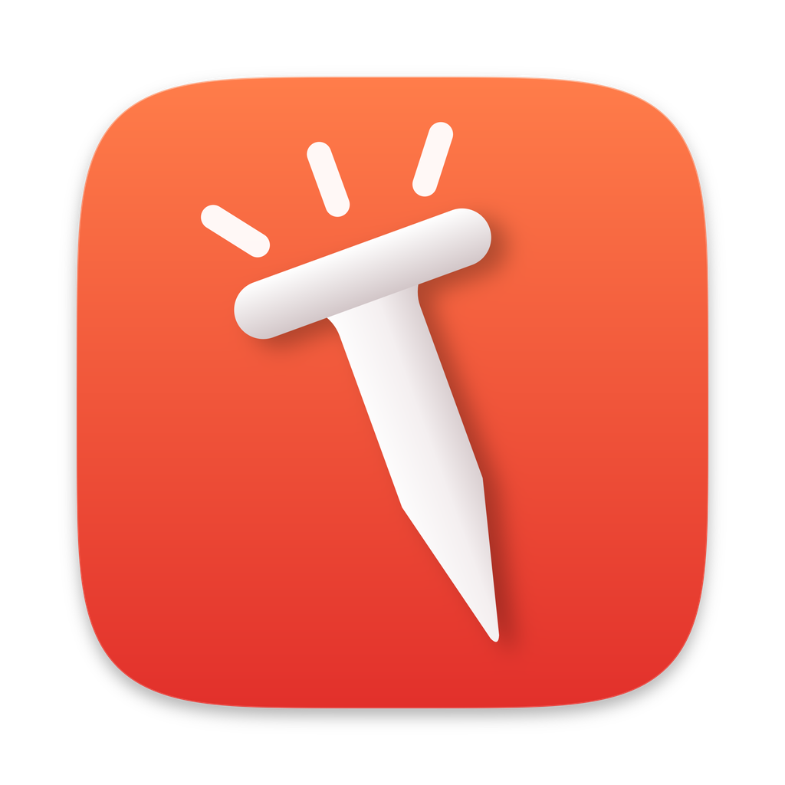

<div align="center">
  
  <h1>Nagl <sub><sup><b>N</b>ot <b>A</b>nother <b>G</b>ame <b>L</b>auncher</sup></sub></h1>
  <p>
    Windows games on your Mac with Apple silicon.<br>
    Sign in to Steam, install a game into a bottle and play it.
  </p>
  <p>
    <a href="../../releases/latest"><b>Download</b></a>
    ·
    <a href="#aion-2">AION 2</a>
    ·
    <a href="../../issues/new?template=run-report.yml">Report a problem</a>
    ·
    <a href="#source-code">Source code</a>
  </p>
</div>

> **Status: preview.** This repo hosts NAGL preview. The source code is available (see
> [Source code](#source-code)), and the code repositories themselves become public soonTM. Nagl has
> been tested on one Mac so far, an M5 Max with macOS 27. Reports from other Macs are the most useful thing you can
> send.

## What is Nagl?

Nagl is a free game launcher for Macs with Apple silicon, in the spirit of CrossOver. Windows programs and games
live in **bottles**, and the app installs, runs and explains them. 

- **Steam inside the app.** Sign in with a QR code, see your library with Mac and Windows badges, and install a game
  into a bottle. Steam for Mac keeps your saves, achievements and DRM working in the background.
- **Native ARM64 first.** The default engine is ARM64 Wine with FEX translating a game's x86-64 code inside the
  process. A second engine, x86_64 Wine under Rosetta, is there for games that need it.
- **Direct3D 10, 11 and 12 on Metal,** through DXMT with a Direct3D 12 implementation of Nagl's own. DLSS and FSR
  upscaling and frame generation can run on Apple's MetalFX.
- **It tells you why.** Every launch keeps its logs. When a game crashes, hangs or is refused, the app says what
  happened and writes a scrubbed report you can attach to an issue here.

## Requirements

- A Mac with Apple silicon. Intel Macs are not supported. **Untested on M1, M2 and M3 Macs:** every test so far
  ran on an M5 Max. Nagl may work there, but games may fail to start, show nothing or run worse than on newer
  chips. If you try it on one, please [report what happened](#reporting-a-problem).
- macOS 26 or later; the default ARM64 engine needs macOS 26.4 or later.
- Steam for Mac, signed in. If it is missing, the app installs it from Valve when you first press **Play**.
- Rosetta only for bottles of the x86_64 engine (`softwareupdate --install-rosetta`).

## Install

1. Download `Nagl-<version>.dmg` from the [latest release](../../releases/latest).
2. Open the disk image and drag **Nagl** onto **Applications**, replacing an older Nagl if you have one.
3. Open Nagl. The app is signed with a Developer ID and notarized by Apple, so it opens without a warning.

To update, install the new disk image the same way. Your bottles, games and Steam sign-in stay where they are. A
bottle keeps its graphics layer until you press **Upgrade** on its page; a new bottle gets the newest one.

## Getting started

1. Open Nagl and go to **Steam**. Scan the QR code with the Steam mobile app. No password passes through the app;
   the session is kept in your macOS Keychain.
2. Make a bottle with **File → New Bottle**. The defaults are the recommended ones.
3. Pick a game from your library, choose **Install…**, then press **Play**. The first start of a Direct3D 12 game
   compiles its shaders, which can take a few minutes; later starts reuse them.

## Adding a game you already downloaded

Have the game's Windows files already, from a Windows PC's Steam folder or an external disk? Nagl can use them
instead of downloading the whole game again. It checks the files you copy in and fetches only what is missing or
different.

1. Sign in on the **Steam** page and make a bottle, as in [Getting started](#getting-started). Note the bottle's
   name and the game's Steam app id (the number in its store page's address, `store.steampowered.com/app/<id>`).
2. In the Finder, copy your existing game folder (on a Windows PC it is `Steam\steamapps\common\<game folder>`)
   into `~/Nagl/Games/Steam/steamapps/common/`, keeping its name. Make the folders if they are not there yet.
3. Close the game and any Steam running in CrossOver or a bottle, then run this in Terminal with your app id and bottle name:

   ```
   /Applications/Nagl.app/Contents/Resources/launcher/nagl steam install <app id> --build windows --bottle "<bottle>" --library ~/Nagl/Games/Steam
   ```

   Nagl checks every file against Steam's, downloads only the parts that are missing or differ, and adds the game
   to the bottle. Checking a big game takes a while, but far less than downloading it. From then on the game shows
   on the Steam page as installed, with **Check Files** in its **…** menu.

This works also when another Steam on your Mac, such as CrossOver's, has the game too: the copy in Nagl's games
folder is the one Nagl plays and updates from then on.

The files have to be the game's Windows version; an older build is fine, since the check brings it up to date. If
you moved the games folder in Settings, use that folder in place of `~/Nagl/Games` in both places.

## Disclaimer 

Some games may perform worse, might not work OOTB, freeze, crash and burn. Nagl aims to eventually support every windows game you  throw at it (besides stuff with kernel anticheat). Try it out with different games. We are venetually looking for games to perform simmilar/better then on rosetta/d3dmetal. We use it as oracle for performance. 


## AION 2

AION 2 runs on Nagl's default ARM64 engine. Install it from the Steam page into a new bottle with the default
settings and press **Play**. The first session builds the game's Metal pipelines, so it stutters at first, mostly on
the way into the world and at the first fights; the next sessions reuse them. On the test Mac (an M5 Max) fights
ran at about 80 fps presented, with FSR 3.1 from 1996x836 to 3440x1440, frame generation and the game's quality
preset 3.

**Please read this before you play.** AION 2 is made for Windows only, and NCSoft does not support playing it on a
Mac, through Nagl, CrossOver or anything else. Nagl does not modify the game, its files or its protection, and
does not switch off or skip any of its checks. Nagl's Wine answers programs as an x64 Windows PC would, as closely
as it can; on the ARM64 engine that includes reporting the x64 processor the emulator provides rather than the Mac's
own. Whether NCSoft accepts playing this way is NCSoft's decision, not ours, and we know of no statement from NCSoft
about it. Playing an online game on an unsupported system is always at your own account's risk.

## Reporting a problem

Open the run on the app's **Runs** page and choose **Report a Problem**: say what happened, and the app writes the
issue's text and a scrubbed archive (your home folder, user name, machine name, Steam account name, serial number and
IP addresses are replaced; save games and Steam credentials are never included). Then
[open a run report](../../issues/new?template=run-report.yml), paste the text and drag the archive into it.

## Source code

Nagl's code is in three repositories (the app, the engines and the graphics layer), which are private for a little
longer and become public soon. Until then, the source is available on request:

**Written offer.** For at least three years from each release, anyone may ask for the complete corresponding source
of that release: the source of every component in it, at the exact commits it was built from, with the scripts that
build it. [Open an issue](../../issues/new?title=Source+request) titled **Source request** and name the release; you
get the archive (`Nagl-<version>-sources.tar`, the one the release build wrote) at no charge beyond the download.
Each release's notes give the archive's SHA-256, so you can check you got the right one.

## Licences

Nagl's own work (the app, its core, the engines' recipes) is under the Mozilla Public License 2.0, and its per-game
data under CC0 1.0. What comes from other projects keeps its licence: DXMT, which the graphics layer extends, and
Wine are LGPL-2.1-or-later, FEX is MIT, DepotDownloader is GPL-2.0, SteamKit2 LGPL-2.1, and Proton's Steam bridge
keeps Valve's terms. Every component's licence text, and the exact version of each, is inside the app at
`Nagl.app/Contents/Resources/licenses/` (`RELEASE.txt` there lists them).

Nagl builds on [Wine](https://www.winehq.org), athei's [wine](https://github.com/athei/wine) and
[FEX](https://github.com/athei/FEX) forks, [FEX](https://github.com/FEX-Emu/FEX),
[DXMT](https://github.com/3Shain/dxmt) by Feifan He (3Shain), [Proton](https://github.com/ValveSoftware/Proton),
[DepotDownloader](https://github.com/SteamRE/DepotDownloader) and [SteamKit2](https://github.com/SteamRE/SteamKit),
and Yuki-fox's [aion2-wine-compat](https://github.com/Yuki-fox/aion2-wine-compat). None of these projects is
involved in Nagl or responsible for it: please report problems here, not to them.

Nagl is not affiliated with or endorsed by NCSoft, Valve, CodeWeavers, Apple, AMD or NVIDIA. AION, Steam, CrossOver,
Metal, MetalFX, DLSS, FSR and the games named here are trademarks of their respective owners.
